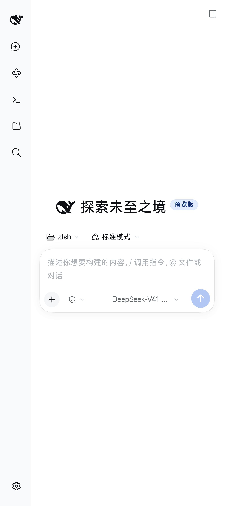

# DeepSeek Harness for Android by X

Author and maintainer of this DHA fork: **夏侯玲文**. Upstream and third-party authors retain their attribution; see [AUTHORS.md](AUTHORS.md) and [NOTICE.md](NOTICE.md).

## 开发说明与致谢

本 App 使用 AI 辅助开发。如遇报错，欢迎提交 Issue，但不保证一定修复。作者最近较忙，可能要等以后有时间再处理。

在此感谢 DeepSeek、ChatGPT 大模型在开发过程中提供的协助。

This app was developed with AI assistance. Bug reports are welcome through Issues,
but fixes are not guaranteed. The maintainer is currently busy and may address them later.
Thanks to DeepSeek and ChatGPT for their assistance during development.

DHA is an unofficial Android distribution of [DeepSeek Harness](https://github.com/deepseek-ai/deepseek-harness).
It runs a Linux userspace inside an Android application and exposes the Harness web UI through WebView.



## Features

- Harness sessions, tools, agents, workflows and skills.
- Floating assistant with Chinese voice/text input and result delivery.
- Android accessibility and optional Shizuku integration.
- Sandbox terminal, storage mounts, file export and recovery mode.
- Built-in plugin surface and offline Chinese Vosk model.

## Status

This repository is a community-maintained fork. It is not affiliated with or endorsed by DeepSeek.
The current source snapshot is `1.2.50` (`versionCode 10263`).

The source tree is prepared for public review, but the full APK distribution still has a documented
corresponding-source gap for the customized `libproot.so`. Read
[`OPEN_SOURCE_COMPLIANCE.md`](OPEN_SOURCE_COMPLIANCE.md) before publishing a binary release.

## Build

Read [`docs/BUILD.md`](docs/BUILD.md) for the complete Linux and Windows toolchain.
The short version is:

```sh
sh docs/run-unit-tests.sh
sh scripts/assemble_payload.sh
python3 scripts/make_payload_zip.py build/rootfs-ubuntu build/payload-assets/payload.zip
sh scripts/build_apk.sh
```

On Windows, set `ANDROID_HOME`, `JAVA_HOME`, and optionally `DSH_PYTHON` and `DSH_REF`,
then run `scripts/build_apk.ps1`. The script no longer contains a maintainer-specific
SDK, JDK, user directory, or repository path.

## Repository layout

- `app/` Android Java sources, resources and bundled Android libraries.
- `plugin/` Harness host/client plugin and tests.
- `payload/` Android-specific sandbox files and vendored local plugins.
- `profile/` Harness profile configuration.
- `patches/` upstream UI and runtime patches.
- `scripts/` build, packaging, update and release tools.
- `docs/` architecture, testing, recovery and release documentation.
- `LICENSES/` third-party license texts.

## Upstream projects and dependencies

DHA is based on the MIT-licensed `itiswdwa/dsh-android` project and packages
DeepSeek Harness, Android libraries, plugins, and a Coopanion-derived AGPL
floating-character renderer. Versions, source links, purposes, licenses, and
known gaps are listed in [`DEPENDENCIES.md`](DEPENDENCIES.md) and
[`THIRD_PARTY.md`](THIRD_PARTY.md). The complete transitive npm and Ubuntu
package trees are resolved during builds, so a release SBOM should be generated
from the exact payload.

## Public release checklist

1. Run JVM and plugin tests.
2. Verify the APK with `apksigner`.
3. Attach the corresponding source archive to every binary release.
4. Keep `LICENSE`, `NOTICE.md`, `THIRD_PARTY.md`, `OPEN_SOURCE_COMPLIANCE.md` and `LICENSES/`.
5. Never commit API keys, credentials, signing keys, APKs, build output or device logs.
6. Set `DSH_REPO=owner/repository` and `DSH_GIT_REMOTE` before using release scripts.

See [`GITHUB_PUBLISHING.md`](GITHUB_PUBLISHING.md) and [`DEPENDENCIES.md`](DEPENDENCIES.md)
for the publication-specific checklist.

## License

Project-owned code and artwork are MIT-licensed. The combined APK also contains Apache-2.0,
GPL and AGPL components; it is not an MIT-only work. See [`THIRD_PARTY.md`](THIRD_PARTY.md),
[`NOTICE.md`](NOTICE.md), [`OPEN_SOURCE_COMPLIANCE.md`](OPEN_SOURCE_COMPLIANCE.md), and
[`LICENSES/`](LICENSES/README.md).
